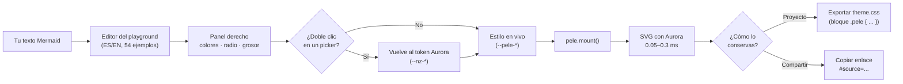

# PeleAurora 🌋✨

Diagramas Mermaid con el diseño de [Aurora](https://github.com/Ntizar/Aurora).

**Playground:** https://ntizar.github.io/PeleAurora/ · **Guía:** https://ntizar.github.io/PeleAurora/guia.html

Escribe Mermaid → SVG instantáneo (motor [pele](https://pele.run), 230 kB, cero
dependencias, 0.05–0.3 ms) vestido con los tokens de Aurora. Edita colores, radio
de esquina y grosor de línea en el panel derecho y exporta tu `theme.css`.

## Cómo funciona

Del texto Mermaid al SVG final: todo síncrono en el navegador, sin build.



 Fuera del playground es igual de directo: enlaza los tres ficheros y llama a
la API (uso completo en «Uso en tu proyecto», más abajo). Apariencia y color
viven siempre en los tokens de Aurora — la tabla del skin lo detalla.

El SVG solo referencia variables CSS: cambiar light/dark lo recolorea sin
re-render.

**27 tipos de diagrama con 54 ejemplos**: flujo, secuencia, clases, estados,
entidad-relación, journey, gantt, tarta, treemap, cuadrantes, mapa mental,
timeline, XY, sankey, bloques, paquetes, kanban, radar, arquitectura, git,
requisitos, C4, event modeling, agentflow, cynefin, ishikawa y Wardley. Cada
tipo trae una plantilla mínima y una variante avanzada (ciclos, subgrafos…).

## Uso en tu proyecto

```html
<link rel="stylesheet" href="https://cdn.jsdelivr.net/gh/Ntizar/Aurora@v10/tokens.css">
<link rel="stylesheet" href="https://cdn.jsdelivr.net/gh/Ntizar/Aurora@v10/marcas/monocromo.css">
<link rel="stylesheet" href="https://cdn.jsdelivr.net/gh/Ntizar/PeleAurora@main/theme-aurora.css">
<script src="https://cdn.jsdelivr.net/npm/pele@1.6.0/dist/pele.global.js"></script>

<div class="pele" id="diagrama"></div>
<script>
  pele.mount(document.querySelector('#diagrama'), `flowchart LR
  A[Mermaid] --> B[SVG con Aurora]`);
</script>
```

Con npm: `npm install pele` y `import { mount } from 'pele'`.

## El skin

`theme-aurora.css` mapea las variables `--pele-*` a los tokens `--nz-*`:

| Variable pele | Token Aurora |
|---|---|
| `--pele-fg` | `--nz-text` |
| `--pele-surface` | `--nz-gray-50` |
| `--pele-border` | `--nz-border-strong` |
| `--pele-accent` | `--nz-brand` |
| `--pele-radius` | `--nz-radius-sm` |
| `--pele-font` | `--nz-font` (Inter self-hosted) |
| `--pele-series-1..8` | paleta «Aurora» (azules y naranjas) |

El SVG referencia variables CSS: cambia el tema (light/dark) y los diagramas se
recolorean solos, sin re-renderizar.

## Personalizar

En el playground, doble clic en un color-picker lo devuelve al valor de Aurora.
Las **series** (gráficos y categorías) tienen 5 paletas estudiadas — Aurora
(azul+naranja, por defecto), Océano, Brasa, Bosque y Prisma (daltonismo-safe) —
cada una con versión light y dark; también puedes afinar los 8 colores a mano.
«Exportar mi tema (.css)» te da el bloque `.pele { … }` exacto con tu tema,
listo para enlazar en tu proyecto con pele. Comparte tu obra con «Copiar
enlace» (la fuente viaja en el hash, como en pele.run).

## Idiomas

ES / EN conmutables desde la barra; el idioma se recuerda.

## Licencias

- Este playground: MIT
- [pele](https://github.com/obsidianmd/pele): MIT (Obsidian)
- [Aurora](https://github.com/Ntizar/Aurora): design system de David Antizar

Hecho con ❤️ por David Antizar
